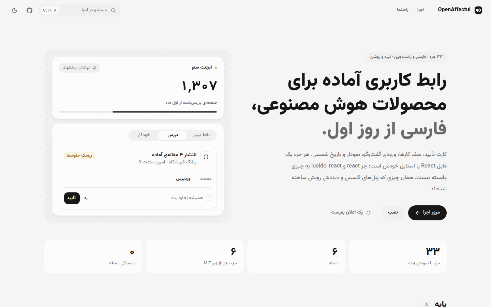
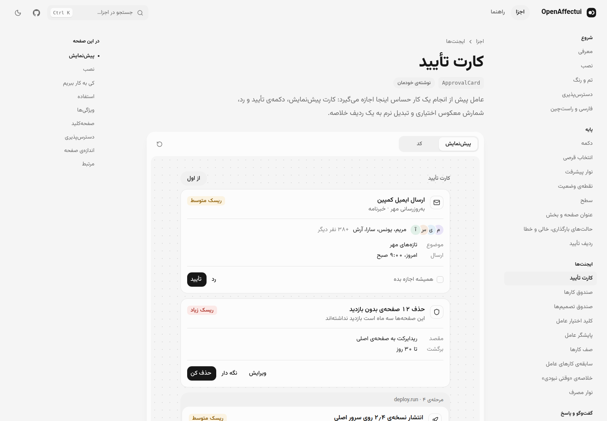

<div align="center">

# OpenAffectui

**React components for agentic products, right-to-left and Persian from day one.**

Approval cards, agent monitors, job queues, autonomy controls, tool-call cards, chat composers, inline diffs, KPI charts and a Jalali date picker. Each one is a single file you copy into your app.

[**Live docs →**](https://openaffectui.odi-v.com) &nbsp;·&nbsp; [Components](https://openaffectui.odi-v.com/components) &nbsp;·&nbsp; [Installation](https://openaffectui.odi-v.com/docs/installation) &nbsp;·&nbsp; [فارسی](#فارسی)


<picture>
  <source media="(prefers-color-scheme: dark)" srcset=".github/assets/home-dark.png">
  
</picture>

</div>

## Why

An AI agent that acts on its own needs an interface that keeps a person in the loop. Someone has to see what the agent is doing right now, approve the risky step before it runs, undo what went wrong, and know how much of the budget is left. Most component libraries stop at buttons and modals, and almost none of them work right to left.

OpenAffectui is built for exactly that layer:

- **Human in the loop.** `ApprovalCard`, `DecisionInbox`, `AgentInbox` and `ConfirmRow` ask before the agent does something that can't be taken back. They support risk levels, countdowns, "always allow", undo and keyboard shortcuts.
- **Watching the agent work.** `AgentMonitor`, `AgentQueue`, `AgentRecap`, `ThinkingLoader` and `ToolCallCard` show steps, tools, retries, workers and rate limits as they happen.
- **Control and trust.** `AutonomyDial` sets how much freedom the agent gets. `AgentLedger` records every action with undo and redo. `UsageMeter` shows spend against the limit.
- **Talking to the agent.** `ChatComposer`, `MessageActions` and `InlineDiff` cover sending, regenerating, feedback, and accepting or rejecting the agent's edits word by word.

It was inspired by [affectUI](https://www.affectui.com), a library of interfaces for AI products. Its free MIT components that fit here were ported and kept under their original licence. Everything else was written from scratch for our own panels.

## What makes it different

- **RTL and Persian first**: Logical CSS properties everywhere, Persian digits, a Jalali calendar, and copy written in Persian, not translated afterwards. Every label can be overridden for other languages.
- **Copy, don't install**: No npm package and no runtime dependencies besides `react` and `lucide-react`. Each component is one `.tsx` file plus one `.css` file you can read and change.
- **Your colours**: Components read the colour tokens your app already has (`--bg`, `--panel`, `--text`, `--primary` and a few more). Light and dark themes follow automatically.
- **Quiet surfaces**: No 1px borders. Layers are separated by tint and soft shadow.
- **Accessible**: Keyboard paths, focus rings, ARIA roles and live regions, and `prefers-reduced-motion` respected in every animation.
- **Real demos**: Every component on the docs site runs live, with its actual source one tab away.



## Components

**Agents:** ApprovalCard · AgentInbox · DecisionInbox · AutonomyDial · AgentMonitor · AgentQueue · AgentLedger · AgentRecap · UsageMeter

**Chat and answers:** ChatComposer · MessageActions · ToolCallCard · InlineDiff · ThinkingLoader

**Data and charts:** ChangeSummary · KpiChart · CompactBreakdown · DateRangePicker (Jalali)

**Forms and sales:** OtpInput · Stepper · PricingPlans

**Motion and feedback:** Toaster · BlurSwap · Shimmer · RollingNumber

**Foundations:** Button · Segmented · Meter · StatusDot · Surface · PageTitle · States (loading, empty, error) · ConfirmRow

Each one has a page with a live preview, props, keyboard map, accessibility notes and "when to use / when not to": [openaffectui.odi-v.com/components](https://openaffectui.odi-v.com/components)

## Quick start

Clone the repo next to your app:

```bash
git clone https://github.com/DragonCuds/openaffectui
```

```
projects/
  openaffectui/   ← this repo
  my-app/
```

Point an alias at the kit. `dedupe` makes sure the page gets one copy of React:

```ts
// my-app/vite.config.ts
import { defineConfig } from 'vite';
import react from '@vitejs/plugin-react';

export default defineConfig({
  plugins: [react()],
  resolve: {
    alias: { '@kit': new URL('../openaffectui/src', import.meta.url).pathname },
    dedupe: ['react', 'react-dom', 'lucide-react'],
  },
});
```

Then add the same path to `tsconfig.json` (`"@kit/*": ["../openaffectui/src/*"]`), import your tokens and the kit styles, and use it:

```tsx
import './styles/tokens.css';
import '@kit/styles/ui.css';
import { ApprovalCard, Toaster, toast } from '@kit/ui';

<ApprovalCard
  title="Publish 4 articles"
  description="Store blog · today at 9:00"
  risk="medium"
  onApprove={async () => { await publish(); toast.success('Published'); }}
  onDeny={() => toast('Held back')}
/>
```

The full steps, including the token list, are in the [installation guide](https://openaffectui.odi-v.com/docs/installation). A ready-made token file is in [`site/src/styles/tokens.css`](site/src/styles/tokens.css).

## Repository

```
src/
  ui/         components, one .tsx each; index.ts exports them all
  styles/     one .css per component; ui.css imports them all
  showcase/   demo scenes used by the docs site
site/         the docs site (Vite + React): pages, guides, search
```

Run the docs site locally:

```bash
cd site
npm install
npx vite          # dev server
npx vite build    # static build in site/dist
```

## Used in

- **accsess**, a panel for making and publishing short animated reels
- **Diddash**, an SEO automation service with agents that ask before they publish

## License

[MIT](LICENSE) © 2026 DragonCuds.

Six components (`DecisionInbox`, `MessageActions`, `ToolCallCard`, `ThinkingLoader`, `ChangeSummary`, `Shimmer`) are adapted from affectUI's free components, MIT © affectui. Their files keep the original notice. This project is independent and is not affiliated with or endorsed by affectUI.

---

<div dir="rtl">

## فارسی

**OpenAffectui** مجموعه‌ای از کامپوننت‌های React برای محصولات ایجنتیک است، یعنی محصولاتی که در آن‌ها هوش مصنوعی خودش کار انجام می‌دهد. همه‌چیز از اول راست‌چین و فارسی ساخته شده است.

وقتی یک ایجنت خودش کار می‌کند، آدم باید بتواند ببیند الان چه می‌کند، پیش از هر کار حساس اجازه بدهد، اشتباه را برگرداند و ببیند چقدر از سهمیه مانده است. این کیت دقیقاً برای همین لایه است: کارت تأیید، صندوق تصمیم‌ها، پایشگر و صف کارهای ایجنت، کلید میزان اختیار، دفتر کارها با برگشت، کارت ابزار، ورودی گفت‌وگو، نمودار و تقویم شمسی.

ایده‌اش از [affectUI](https://www.affectui.com) آمده است. کامپوننت‌های رایگان آن که به کار ما می‌آمدند با مجوز MIT و همراه نوشته‌ی مجوزشان آورده شده‌اند. بقیه را خودمان از صفر نوشته‌ایم.

- هر کامپوننت یک فایل `.tsx` و یک فایل `.css` است. کپی‌اش می‌کنید و هر جا لازم بود تغییرش می‌دهید.
- جز `react` و `lucide-react` به چیزی وابسته نیست.
- رنگ‌ها را از توکن‌های خود برنامه می‌گیرد و تم تیره و روشن خودکار کار می‌کند.
- هیچ خط حاشیه‌ی ۱ پیکسلی ندارد. صفحه‌کلید، دسترس‌پذیری و حرکت کم هم رعایت شده‌اند.

مستندات و نمونه‌ی زنده‌ی همه‌ی اجزا: **[openaffectui.odi-v.com](https://openaffectui.odi-v.com)**

</div>
